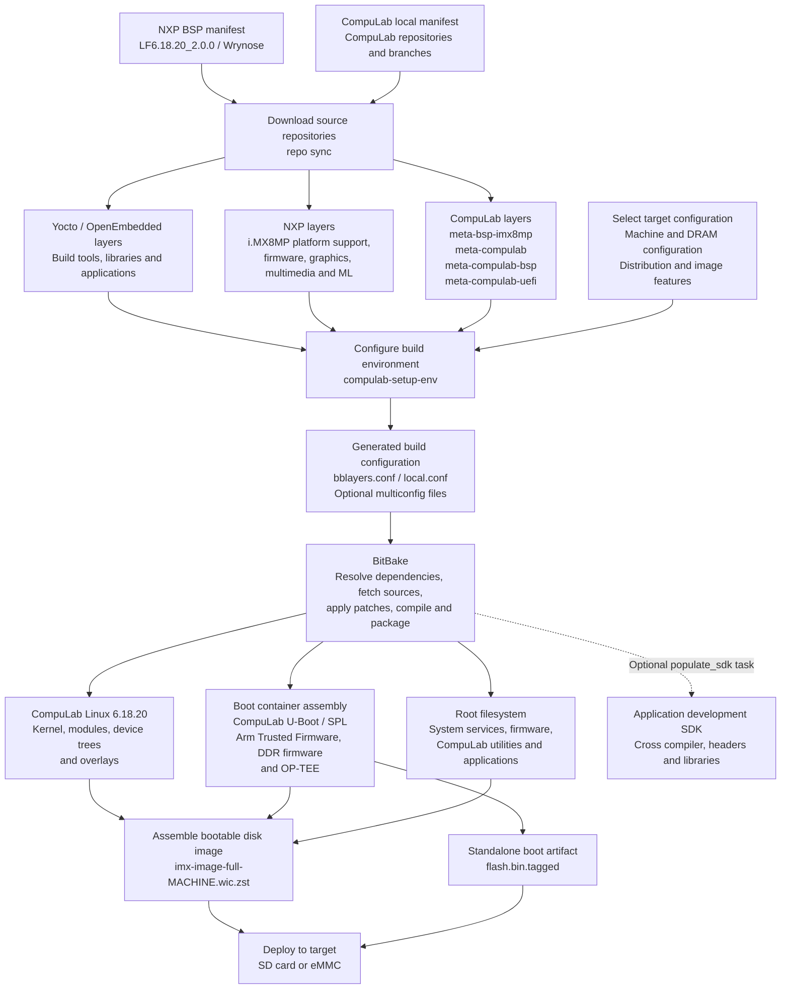

# CompuLab i.MX8M Plus BSP Build Flow

This document describes the source-level build flow of
[`meta-bsp-imx8mp`](https://github.com/compulab-yokneam/meta-bsp-imx8mp/tree/wrynose-6.18.20-2.0.0),
branch `wrynose-6.18.20-2.0.0`, reviewed at commit
`6f474d3422bf8e84aa685e16409e083a09e073f4`.
The branch's [README](https://github.com/compulab-yokneam/meta-bsp-imx8mp/blob/6f474d3422bf8e84aa685e16409e083a09e073f4/README.md)
identifies it as a development branch. This review did not include a build.

## Overview

CompuLab extends the NXP Linux BSP with board-specific kernel, bootloader,
device-tree, firmware, and system integration. Yocto and BitBake combine these
components into a bootable Linux image and an optional application development
SDK.

## Block Diagram



## Component Responsibilities

| Component | Role in this BSP |
|---|---|
| NXP manifest | Selects the underlying NXP BSP release and its repositories |
| CompuLab manifest | Adds the CompuLab repositories and setup helper |
| `meta-bsp-imx8mp` | Selects the board configuration, CompuLab kernel and bootloader, device trees, and DRAM settings |
| Shared CompuLab layers | Supply common utilities, desktop, graphics, multimedia, and other integration |
| BitBake | Builds packages and assembles the selected image and optional SDK |

The [machine configuration](https://github.com/compulab-yokneam/meta-bsp-imx8mp/blob/6f474d3422bf8e84aa685e16409e083a09e073f4/conf/machine/compulab-imx8mp.inc)
selects `linux-compulab` and `u-boot-compulab`. The latter also provides
`imx-boot`, so boot container assembly belongs under the CompuLab U-Boot build
in this diagram.

The [setup helper](https://github.com/compulab-yokneam/meta-bsp-imx8mp/blob/6f474d3422bf8e84aa685e16409e083a09e073f4/tools/compulab-setup-env)
initializes the NXP build environment and applies CompuLab configuration
templates for new build directories. It also installs the supplied multiconfig
files when entering new or existing build environments.

## Standard Build

After downloading and synchronizing the NXP and CompuLab repositories as
described in the layer's README, configure and build UCM-iMX8M-Plus with:

```bash
export MACHINE=ucm-imx8m-plus
source compulab-setup-env build-${MACHINE}

bitbake imx-image-full
```

Select the DRAM configuration appropriate to the hardware. The layer documents
`d1d8` and `d2d4` configurations, with a different configuration approach for
MCM-iMX8Pv2. See the [DRAM documentation](https://github.com/compulab-yokneam/meta-bsp-imx8mp/blob/6f474d3422bf8e84aa685e16409e083a09e073f4/Documentation/dram.md).

The SDK is a separate build task:

```bash
bitbake imx-image-full -c populate_sdk
```

## Optional Build Extensions

The layer supports grouped family images and multiple machine/DRAM bootloader
builds. These extend the standard per-machine flow and are described in the
[advanced features documentation](https://github.com/compulab-yokneam/meta-bsp-imx8mp/blob/6f474d3422bf8e84aa685e16409e083a09e073f4/Documentation/advanced-features.md).

- `SUPER_EVK` and `SUPER_IOT` add related device payloads to an image. The selected
  machine still controls the bootloader and default device tree.
- DRAM multiconfig builds create boot containers for both `d1d8` and `d2d4`.
- The explicit `u-boot-compulab-multi` target builds a family bootloader bundle;
  it is separate from the normal image build.

## Suggested Diagram Caption

> **CompuLab i.MX8M Plus BSP build flow:** CompuLab extends the NXP Linux BSP
> with board-specific kernel, bootloader, device-tree, firmware, and system
> integration. Yocto and BitBake combine these components into a bootable Linux
> image and an optional application development SDK.
